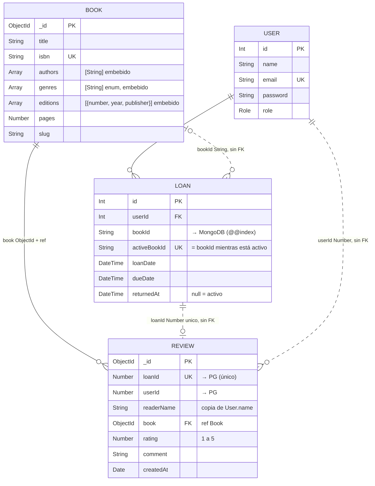

# Tarea individual U2 · Modelo híbrido PostgreSQL + MongoDB

**Estudiante:** Esteban Santiago Recalde Logacho  **N.º de lista:** 13  **Caso:** 1 · Biblioteca

> Mismo formato que el workload del material de Modelado (lección 2.2) y que el ejemplo resuelto de la clínica
> (`docs/ejemplo_clinica/Workload_clinica_hibrida.md`). Cada operación agrega la fila **Base**.

## 1. Workload

### 1.1 Casos de uso
- Una biblioteca atiende a ~3 000 lectores registrados que buscan libros en el catálogo y piden préstamos.
- Un libro (ejemplar) se presta a un lector con fecha de préstamo y fecha límite; luego el lector lo devuelve.
- Después del préstamo, el lector puede dejar **una** reseña de ese préstamo (nota de 1 a 5 y comentario).
- Los lectores consultan el catálogo, su historial de préstamos y las reseñas de cada libro.
- El bibliotecario mantiene el catálogo de libros (autores, géneros y ediciones).

### 1.2 Datos principales (cuántos actores, cuántos registros, cuánto tiempo se guardan)
- Lectores: 3 000 (crecen ~80 por mes); ~1 200 activos al día.
- Bibliotecarios: 5.
- Libros en el catálogo: ~20 000.
- Préstamos: ~400 por día (~730 000 en 5 años).
- Reseñas: ~100 por día (1 de cada 4 préstamos). **Crecen sin límite** (~180 000 en 5 años).
- Período: los préstamos y reseñas se guardan 5 años.

### 1.3 Suposiciones (lo que puede cambiar)
- Un libro **no se presta dos veces a la vez** (integridad fuerte): mientras tenga un préstamo activo, no se puede prestar otra vez.
- Un préstamo tiene como máximo **una** reseña.
- El nombre del lector casi nunca cambia: se puede copiar en la reseña.
- Cada libro tiene datos distintos: uno o varios autores, uno o varios géneros y un número variable de ediciones.
- El catálogo se lee muchísimo más de lo que se modifica.
- Las reseñas se muestran por libro, las más nuevas primero, con el promedio y el total.

### 1.4 Operaciones (mínimo 6, una tabla por operación)

| Actor: | Lector |
|---|---|
| Descripción: | Busca libros en el catálogo por título o autor, con orden y solo los campos que necesita |
| Tipo de operación: | Lectura |
| Datos en la operación: | title, authors, genres, pages (búsqueda `?q=`, proyección `?fields=`, orden `?sort=`) |
| Frecuencia: | varias búsquedas en cada visita |
| Tasa: | ~20 000 / día |
| Base: | **MongoDB** (documento listo para mostrar, sin joins) |

| Actor: | Lector |
|---|---|
| Descripción: | Ve el detalle de un libro con todas sus ediciones |
| Tipo de operación: | Lectura |
| Datos en la operación: | todo el documento Book (authors[], genres[], editions[]) |
| Frecuencia: | al abrir un libro |
| Tasa: | ~8 000 / día |
| Base: | **MongoDB** (las ediciones van embebidas: una sola consulta) |

| Actor: | Lector |
|---|---|
| Descripción: | Pide un préstamo de un libro |
| Tipo de operación: | Escritura |
| Datos en la operación: | bookId, dueDate; userId (del JWT) |
| Frecuencia: | picos entre 10:00 y 12:00 |
| Tasa: | ~400 / día |
| Base: | **PostgreSQL** (integridad: un libro no se presta dos veces a la vez); lee MongoDB para validar `bookId` |

| Actor: | Lector |
|---|---|
| Descripción: | Devuelve el libro prestado |
| Tipo de operación: | Escritura |
| Datos en la operación: | id del préstamo, returnedAt; userId (del JWT) |
| Frecuencia: | casi tantas como préstamos |
| Tasa: | ~400 / día |
| Base: | **PostgreSQL** (libera el libro para un nuevo préstamo) |

| Actor: | Lector |
|---|---|
| Descripción: | Ve su historial de préstamos con el título y los autores de cada libro |
| Tipo de operación: | Lectura |
| Datos en la operación: | préstamos (PostgreSQL) + title, authors (MongoDB) |
| Frecuencia: | cada lector activo, ~1 vez al día |
| Tasa: | ~1 500 / día |
| Base: | **Las dos**: se une en el servicio con `$in` + `Map` (2 consultas, sin N+1) |

| Actor: | Lector |
|---|---|
| Descripción: | Deja una reseña de su préstamo |
| Tipo de operación: | Escritura |
| Datos en la operación: | loanId, rating, comment; userId del JWT; readerName copiado de PostgreSQL; book tomado del préstamo |
| Frecuencia: | 1 de cada 4 préstamos |
| Tasa: | ~100 / día (sin límite en el tiempo: ~180 000 en 5 años) |
| Base: | **MongoDB**, colección aparte; lee PostgreSQL para validar el préstamo (404) y su dueño (403) |

| Actor: | Lector (o visitante) |
|---|---|
| Descripción: | Lee las reseñas de un libro con el promedio y el total |
| Tipo de operación: | Lectura |
| Datos en la operación: | readerName, rating, comment, createdAt; promedio y conteo (`aggregate`) |
| Frecuencia: | al abrir un libro |
| Tasa: | ~4 000 / día |
| Base: | **MongoDB** solamente (por eso se copia `readerName`) |

| Actor: | Bibliotecario |
|---|---|
| Descripción: | Crea o edita un libro del catálogo |
| Tipo de operación: | Escritura |
| Datos en la operación: | todos los campos del libro (authors[], genres[], editions[]) |
| Frecuencia: | cuando llegan libros nuevos |
| Tasa: | ~30 / día |
| Base: | **MongoDB** |

| Actor: | Bibliotecario |
|---|---|
| Descripción: | Elimina un libro del catálogo |
| Tipo de operación: | Escritura |
| Datos en la operación: | _id; conteo de préstamos que lo usan |
| Frecuencia: | casi nunca (libros dados de baja) |
| Tasa: | ~2 / mes |
| Base: | **MongoDB**, revisando PostgreSQL (409 si tiene préstamos; si no, borra sus reseñas) |

### 1.5 Entidades

- **PostgreSQL**
  - User (ya existe, del login)
    - Loan (1:N, FK `userId`)
- **MongoDB**
  - Book
    - authors[], genres[], editions[] (embebidos)
    - Review (1:N, `book` ObjectId + ref)
  - Review
- **Entre bases (sin FK)**
  - Loan.bookId → Book._id (String)
  - Review.loanId → Loan.id (Number, único)
  - Review.userId → User.id (Number) · Review.readerName (copia de User.name)

### 1.6 Observaciones (qué domina: lectura o escritura, qué crece sin límite, qué necesita integridad)
- Dominan las **lecturas**: ~33 500 lecturas frente a ~930 escrituras al día (unas 36 lecturas por cada escritura). Lo que más se lee (catálogo y reseñas) debe salir de una sola consulta.
- Lo único que crece sin límite son las reseñas: van en su propia colección, nunca embebidas en el libro (límite de 16 MB por documento).
- El préstamo necesita integridad (un libro no se presta dos veces a la vez): se queda en PostgreSQL. Lo garantiza la base con el campo `activeBookId` único (vale `bookId` mientras el préstamo está activo y `null` al devolverlo; PostgreSQL permite varios `null` en un campo único).
- `readerName` se copia porque la lista de reseñas se lee ~4 000 veces al día y el nombre casi no cambia.
- Índices que pide el workload: `Loan.bookId` con `@@index` y `Loan.activeBookId` único (PostgreSQL); `reviews.loanId` único y `reviews { book: 1, createdAt: -1 }` (MongoDB); `books.isbn` único.

## 2. ¿PostgreSQL o MongoDB?

| Entidad | ¿Transacciones o choques? | ¿Otras dependen por FK? | ¿Forma variable? | ¿Crece sin límite? | ¿Se lee mucho más? | Base |
|---|---|---|---|---|---|---|
| User | Sí: email único en el registro y login | Sí: Loan depende de User | No: campos fijos | No: ~80 por mes | Se lee en cada login | **PostgreSQL** (ya existe) |
| Loan | Sí: dos lectores no pueden llevarse el mismo libro a la vez | Sí: depende de User; Review lo apunta | No: campos fijos (fechas, ids) | Crece (~400/día), pero con forma fija y se consulta por índice | Lectura y escritura parecidas | **PostgreSQL** |
| Book | No: lo edita solo el bibliotecario | No por FK: Loan lo apunta con un String | Sí: autores, géneros y ediciones cambian de un libro a otro | No: ~20 000 | Sí: ~28 000 lecturas frente a ~30 escrituras al día | **MongoDB** |
| Review | No: una por préstamo, lo resuelve un índice único | No | Poco: el comentario es opcional | **Sí**, sin límite | Sí: ~4 000 lecturas frente a ~100 escrituras al día | **MongoDB** (colección aparte) |

## 3. Relaciones dentro de MongoDB: embeber o referenciar

| Relación | Cardinalidad | ¿Se lee junto? | ¿Cambia seguido? | ¿Crece sin límite? | Decisión |
|---|---|---|---|---|---|
| Book → authors | 1 : pocos (1 a 5) | Sí, siempre se muestran con el libro | Casi nunca | No | **Embeber** `authors: [String]` |
| Book → genres | 1 : pocos (1 a 3) | Sí | Casi nunca | No | **Embeber** `genres: [String]` (enum) |
| Book → editions | 1 : pocos (≤ 10) | Sí, en el detalle del libro | Rara vez (una edición nueva cada varios años) | No | **Embeber** `editions: [{ number, year, publisher }]` |
| Book → Review | 1 : N | No: las reseñas se leen aparte, paginadas | Se agregan todos los días | **Sí** | **Referenciar** `Review.book` (ObjectId + ref) |

## 4. ERD híbrido (notación pata de gallo, como el material 2.1)

Dos zonas: **PostgreSQL** (USER, LOAN) y **MongoDB** (BOOK, REVIEW).
Línea continua: FK de PostgreSQL o `ref` de Mongoose. **Línea punteada: referencia entre bases** (sin FK).

## 5. Referencias

| Referencia | Se guarda como | La garantiza | Se une con |
|---|---|---|---|
| Loan.userId → User.id | `Int` con FK | PostgreSQL (FK) | `include` de Prisma |
| Loan.bookId → Book._id | `String?` (24 hex) | El servicio: `isValidObjectId` + `Book.exists` al crear el préstamo | `$in` + `Map` en el historial |
| Review.book → Book._id | `ObjectId` + `ref: "Book"` | Mongoose (ref); el servicio lo toma del préstamo | `populate` |
| Review.loanId → Loan.id | `Number`, índice único | El servicio: `prisma.loan.findUnique` (404) y dueño (403); el índice único evita la segunda reseña (409) | consulta a Prisma por id |
| Review.userId → User.id | `Number` | Sale del JWT (no del body) | no se une: se usa `readerName` copiado |

## 6. Dato copiado entre bases (desnormalización)

- Dato: `User.name` se copia en `Review.readerName`.
- Por qué (operación del workload): la lista de reseñas de un libro se lee ~4 000 veces al día; con la copia sale solo de MongoDB, sin ir a PostgreSQL por cada reseña.
- Costo: si el lector cambia su nombre, las reseñas viejas guardan el nombre anterior; ocupa un poco más de espacio, y crear la reseña hace una consulta extra a PostgreSQL (aceptable, son solo ~100 al día).

## 7. Endpoints

| Método y ruta | Base(s) | Respuestas posibles |
|---|---|---|
| `POST /api/auth/register` · `POST /api/auth/login` | PostgreSQL | 201 / 200 / 400 / 401 (ya existen) |
| `GET /api/books?q=&fields=&sort=` | MongoDB | 200 |
| `GET /api/books/:id` | MongoDB | 200 / 400 / 404 |
| `POST /api/books` (JWT) | MongoDB | 201 / 400 / 401 |
| `PUT /api/books/:id` (JWT, `findById` + `save()`) | MongoDB | 200 / 400 / 401 / 404 |
| `DELETE /api/books/:id` (JWT) | MongoDB + PostgreSQL | 200 / 400 / 401 / 404 / 409 (tiene préstamos) |
| `POST /api/loans` (JWT) | PostgreSQL, valida MongoDB | 201 / 400 / 401 / 404 (libro no existe) / 409 (libro ya prestado) |
| `PATCH /api/loans/:id/return` (JWT) | PostgreSQL | 200 / 401 / 403 / 404 |
| `GET /api/loans/me` (JWT) | PostgreSQL + MongoDB (`$in` + `Map`) | 200 / 401 |
| `DELETE /api/loans/:id` (JWT) | PostgreSQL + MongoDB (borra su reseña) | 200 / 401 / 403 / 404 |
| `POST /api/reviews` (JWT) | MongoDB, valida PostgreSQL | 201 / 400 / 401 / 403 (préstamo de otro) / 404 (préstamo no existe) / 409 (ya tiene reseña) |
| `GET /api/reviews?book=:id` | MongoDB (`populate`, orden por fecha, `aggregate` promedio y conteo) | 200 / 400 |
